<p align="center">
  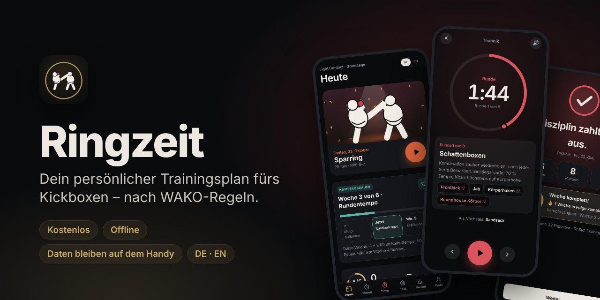
</p>

<p align="center">
  <a href="https://dnsmaur1992.github.io/ringzeit/"></a>
</p>

<p align="center">
  
  
  
  
  
</p>

**Ringzeit** plant dein Kickbox-Training neben dem Verein – passend zu deiner Disziplin, deinem Level und deinen Trainingstagen. Runden, Kombinationen und Übungen kommen fertig dosiert aufs Handy, der Rundentimer läutet die Glocke, und am Ende siehst du, was du geschafft hast. Die Regeln richten sich nach der WAKO.

> **Neu hier?** Öffne die [Installationsanleitung](https://dnsmaur1992.github.io/ringzeit/installieren.html) auf deinem Handy – mit QR-Code und Schritt-für-Schritt-Hilfe für iPhone und Android.

**Dein erster Trainingsstart:** Heute → Tagesplan sichten und Ausrüstung bereitlegen → **Training beginnen** (oben oder unter dem Plan). Danach führt dich Ringzeit **Übung für Übung im Vollbild** durch die Einheit – mit 10 Sekunden Vorbereitung, Gong und Ansage, bei Kraft mit Satz-Tabelle – bis zum Abschluss. ✕ führt zurück zur Planübersicht und pausiert die Timer. Die Tour hat nur sechs Schritte; Einrichtung und Tour können übersprungen werden; die Tour ist unter **Profil → App & Daten** erneut erreichbar.

---

## Inhalt

- [Screenshots](#screenshots)
- [Funktionen](#funktionen)
- [Installation](#installation)
- [Deine Daten](#deine-daten)
- [Updates veröffentlichen](#updates-veröffentlichen)
- [Technik](#technik)
- [Hinweise](#hinweise)

---

## Screenshots

<table>
  <tr>
    <td align="center">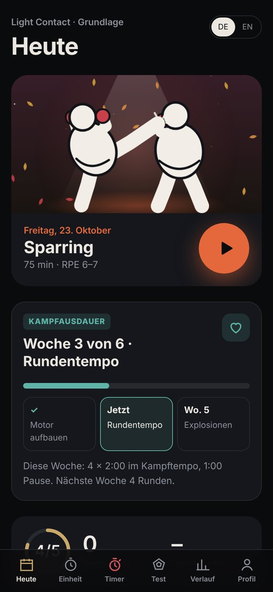<br><sub><b>Heute</b> – nächste Einheit und Fortschritt</sub></td>
    <td align="center">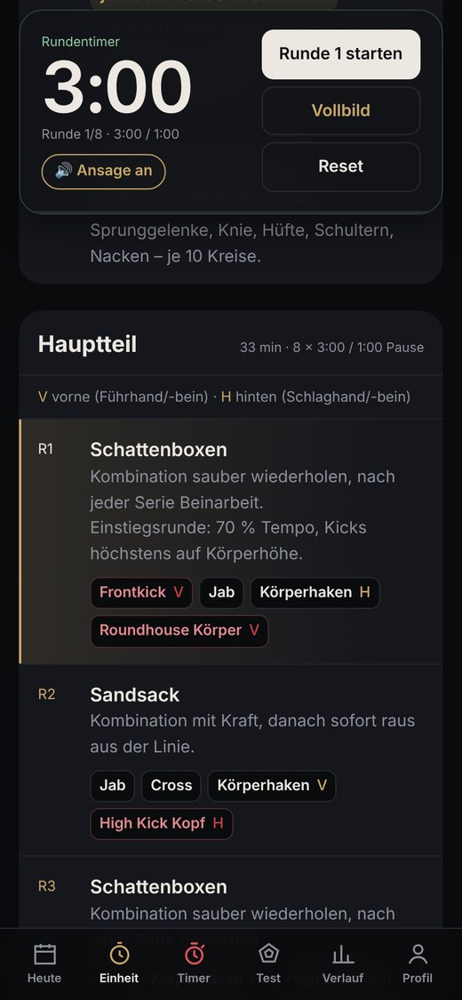<br><sub><b>Einheit</b> – Runden mit Kombinationen</sub></td>
    <td align="center">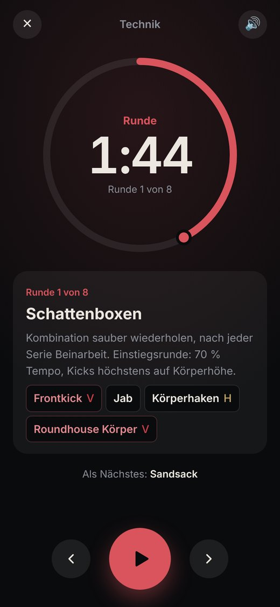<br><sub><b>Vollbild-Timer</b> mit Ansage</sub></td>
    <td align="center">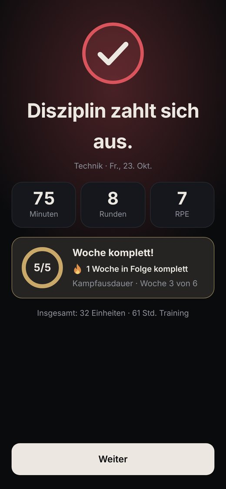<br><sub><b>Abschluss</b> – Woche und Serie</sub></td>
  </tr>
  <tr>
    <td align="center">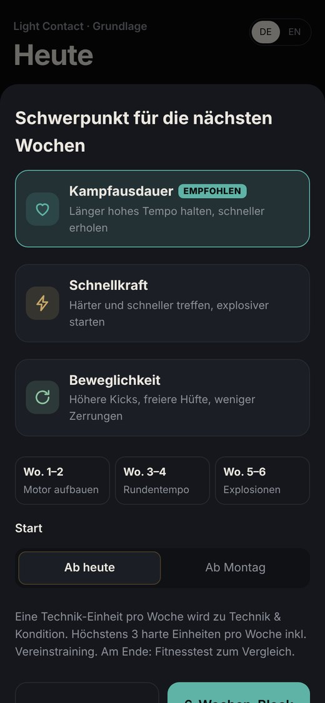<br><sub><b>Schwerpunkt</b> – 6-Wochen-Blöcke</sub></td>
    <td align="center">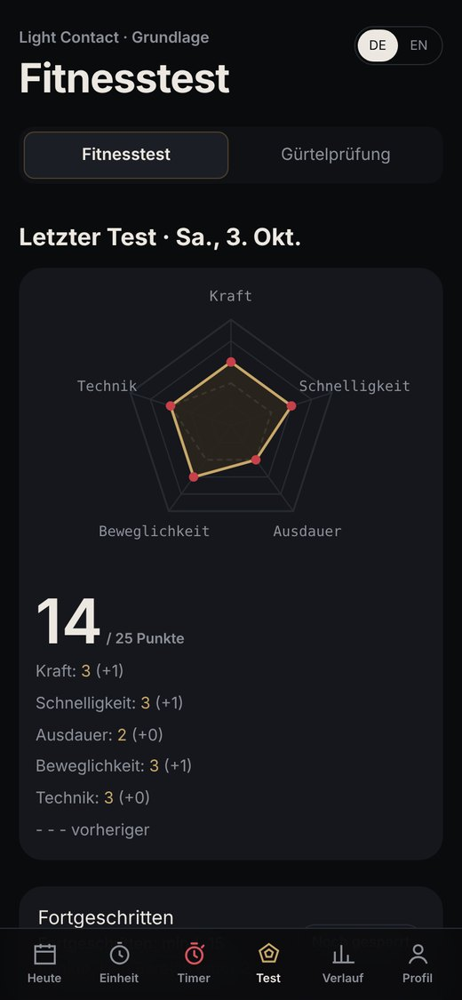<br><sub><b>Fitnesstest</b> mit Vergleich</sub></td>
    <td align="center">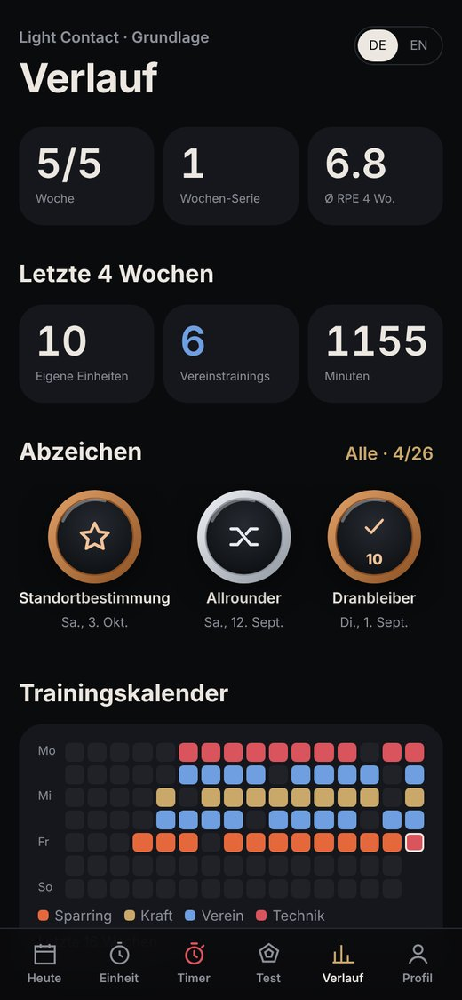<br><sub><b>Verlauf</b> – Abzeichen und Kalender</sub></td>
    <td align="center">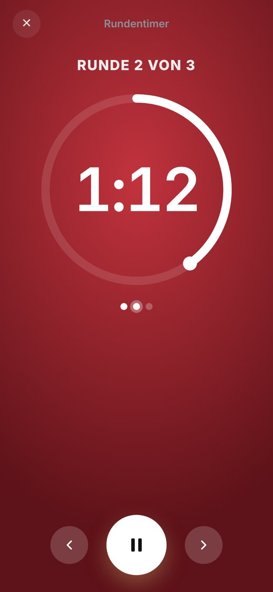<br><sub><b>Rundentimer</b> mit Ringglocke</sub></td>
  </tr>
  <tr>
    <td align="center">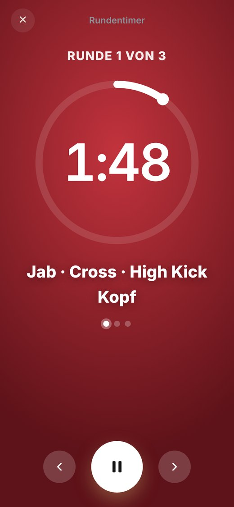<br><sub><b>Coach-Modus</b> – Kombis werden angesagt</sub></td>
    <td align="center">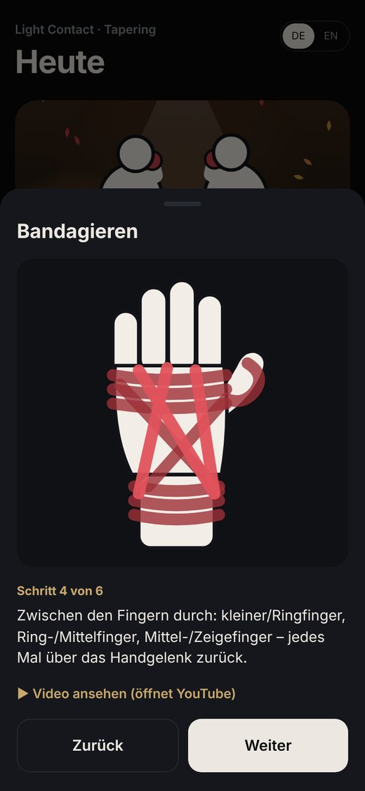<br><sub><b>Bandagieren</b> – Schritt für Schritt</sub></td>
    <td align="center">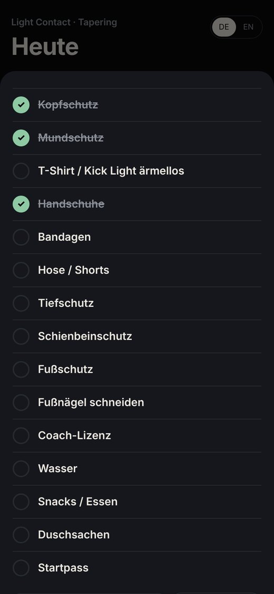<br><sub><b>Packliste</b> für den Turniertag</sub></td>
    <td align="center">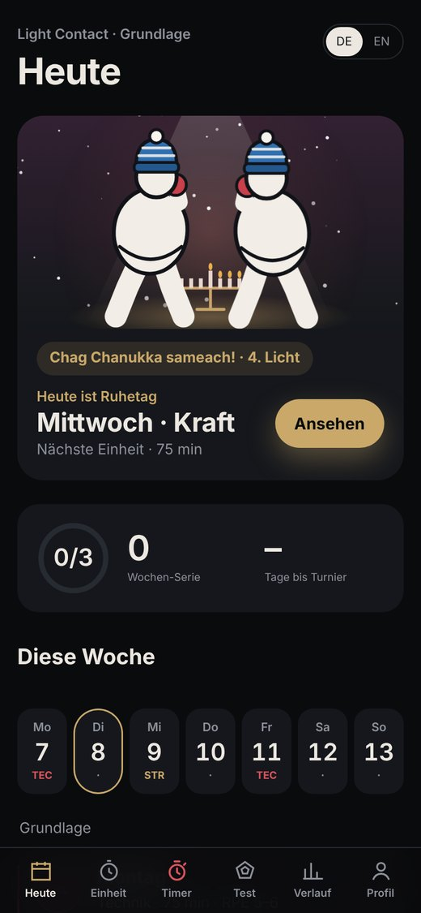<br><sub><b>Feiertage</b> – hier Chanukka</sub></td>
  </tr>
</table>

---

## Funktionen

### 🥊 Training, das zu dir passt
- **Einfach oder ausführlich:** In der Einrichtung wählbar (für neue Nutzer ist „Einfach“ vorausgewählt), später unter Profil → App & Daten. Einfach zeigt auf Heute nur das Training; Fitnesstest und Verlauf liegen dann im Profil statt in der Leiste. Auch „Einheit anpassen“ fragt dann nur Trainingsart, Dauer, Ort und Partner/Sandsack – ohne Tagesform, Zusatz-Geräte und Fachbegriffe
- **Anstrengung mit Gesichtern:** fünf Stufen von 😌 „Sehr locker“ bis 🥵 „Am Limit“; in der ausführlichen Ansicht zusätzlich die genaue Skala 1–10
- **Wochenplan** für Light Contact, Kick Light, Full Contact und K1 Style – abgestimmt auf Trainingstage, Dauer, Level und Vereinstraining
- **Einheiten** für Technik, Technik & Kondition, Sparring, Kraft, Kondition und Mobility – zu Hause, in der Halle, draußen oder im Fitnessstudio
- **Kombinationen** passend zum Level, mit Führ- und Schlaghand-Hinweis; eigene Kombis aus dem Verein werden eingebaut
- **Partnerrunden mit Gegenaktion** (als Ausnahme: pro Einheit 1 bei Grundlage, 2–4 bei Fortgeschritten, 3–6 bei Wettkampf): Der Partner greift mal zuerst an, unterbricht mittendrin oder kontert am Ende – mit passender Verteidigung (Parieren, Slippen, Abducken, Doppeldeckung, Rausgehen, Ableiten; ab Fortgeschritten auch Fußfeger mit Fuß anheben; in Kick Light und K1 Low Kick mit Checken bzw. Schienbein-Block; in K1 Knie mit Abblocken), ab Fortgeschritten oft mit sofortiger eigener Antwort, bei Wettkampf auch als doppelter Schlagabtausch; in Full Contact mit Deckungs-Hinweis. Wer was macht, zeigen farbige Rahmen (A hellblau, B gelb)
- **Klare Ziele:** Jeder Tritt und jedes Knie nennt sein Ziel (Kopf, Körper, Oberschenkel) und die Seite (V/H); Schläge zum Körper (Jab, Cross, Haken) kommen in jeder Einheit vor.
- **Disziplin spürbar:** Leichtkontakt mit kurzen, schnellen Kombis und Kontrolle; Full Contact mit Wirkung am Sandsack, mehr Körpertreffern, mehr Druck im Partnerdrill und der 6-Kick-Regel auch mit Partner.
- **Partnerrunden von leicht zu schwer:** Die Kombinationen steigern sich über die Einheit
- **Vereinstage und Ringzeit-Tage** getrennt eintragen: eigene Einheiten werden neben dem Verein geplant
- **Kinder-Modus (8–12 Jahre):** kürzere Einheiten und angepasste Übungen und Belastungen
- **Weitere Kicks:** Brazilian Kick, Spinning Hook Kick, Tornado Kick und gesprungenes Knie; Axe-Kick ab Fortgeschritten
- **Full Contact und K1 Style erst ab 15 Jahren** und mit freigeschaltetem Trainingslevel
- **Klare Dosierung** bei jeder Übung: Wiederholungen, Sekunden, Strecke oder Minuten
- **Sicherer Einstieg:** Aufwärmen mit kurzem Andehnen, Einstiegsrunden ohne Kopftritte
- **Skizzen** zu allen Übungen, die nicht selbsterklärend sind
- Rücksicht auf **Einschränkungen** (Knie, Schulter, Handgelenk, Rücken, Sprunggelenk), Alter und Erholungsbedarf

### ⏱️ Rundentimer
- **Vollbild-Timer** mit Ringglocke, 10 Sekunden Vorbereitungszeit und Ansage der Übung
- **Planvorschau vor dem Training:** „Einheit“ zeigt den Tagesplan zum Ansehen und Bereitlegen der Ausrüstung; „Training beginnen“ steht oben und unter dem Plan
- **Ein Bildschirm, eine Übung:** Nach „Training beginnen“ läuft die Einheit Schritt für Schritt im Vollbild – Aufwärmen, Hauptteil, Zusatzteil, Abhärtung, Cool-down, Abschluss
  - **Zeitübungen** starten mit 10 Sekunden „Bereit machen“ und Ansage, laufen mit Gong und gehen danach von selbst zur nächsten Übung
  - **Übungen ohne feste Zeit** (Wiederholungen, Strecke, Gelenkkreise) schließt du mit ✓ ab – Zeiten werden nicht erfunden
  - **Kraft:** Satz-Tabelle auf demselben Bildschirm, Wiederholungen von Hand eintragen, ✓ startet die Satzpause mit Gong
  - **Halteübungen** wie Unterarmstütz laufen wie Runden: Halten → Pause → nächster Satz, die Sekunden werden eingetragen
  - **Einbeinige Übungen** mit eigenem Feld für links und rechts, egal ob Wiederholungen oder Sekunden
  - **10 Sekunden vor Ende** jeder Phase ein Ton und eine Ansage („Noch 10 Sekunden“, in Pausen: was als Nächstes kommt)
  - **Ton-Hinweis:** iPhone – Schalter an der Seite auf Ton; Android – Medienlautstärke hochdrehen
  - **Zirkel** Durchgang für Durchgang, alle Übungen des Durchgangs sichtbar, mit Pause zwischen den Durchgängen
  - **Runden** über den bekannten Rundentimer; danach geht es direkt weiter
  - Zurück, Weiter, Pause und „Vorzeitig abschließen“ jederzeit; die Abschnittsübersicht liegt unter ☰. Die Position wird pro Einheit gespeichert
- **Übungstimer:** Zeitvorgaben im Aufwärmen und Cool-down, beidseitige Dehnungen mit Seitenwechsel, Conditioning-Intervalle sowie einzelne zeitbasierte Kraftsätze. Bei Zeitspannen kann die Dauer gewählt werden; Wiederholungsübungen bleiben ohne erfundene Zeitvorgabe.
- **Gemeinsame Timersteuerung:** Runden-, Übungs- und freier Timer teilen sich eine Uhr; beim Wechsel wird der andere Timer pausiert, beim endgültigen Einheitsabschluss werden Timer und ausstehende Ansagen beendet
- **Weniger Hintergrundarbeit:** sekundengenau geplante Timeraufrufe während des Trainings, keine dauernde Abfrage im Leerlauf; verdeckte Anzeigen werden nicht laufend neu geschrieben
- **Bildschirm und Animationen bleiben erhalten:** Die Restzeit ist während laufender Runden und Pausen sichtbar. Die Audiowachhaltung bleibt auf Apple-Mobilgeräten erhalten; andere Audiokontexte können zwischen Signalen ruhen
- Eigener **Rundentimer** mit Vorlagen (WAKO, K1, Sparring, Pratzen, HIIT)
- Im Vollbild bleiben **Start, Zurück und Weiter immer sichtbar**, auch bei langen Übungstexten und kleinen Handys
- Leuchtring mit Fortschritt, pulsierende letzte 10 Sekunden und ein Blitz zum Rundenende
- **Automatischer Rundenwechsel im geführten Training:** Nach der Pause läuft die nächste Runde direkt weiter; die 10 Sekunden Vorlauf gibt es nur beim manuellen Start
- **Musik bei den Rundentimern** im Profil wählen; der Bildschirm bleibt mit unterstütztem Wake Lock während des Timers an
- **Coach-Modus:** ruft während der Runde Kombis aus deinem Level aus – wie der Trainer am Ring
  - Im freien Rundentimer schaltet der Knopf oben rechts (🔊/🔈) die Ansagen an und aus; wer die Coach-Ansagen einschaltet, schaltet die Sprache automatisch mit ein
  - Auf dem iPhone wird die Sprachausgabe beim ersten Tipp nach jedem App-Start automatisch freigeschaltet – ohne Umschalten
  - Ringzeit nutzt automatisch die **beste installierte Stimme** (Premium vor Erweitert vor Standard, keine Spaß- oder reinen Online-Stimmen). Unter Profil → App & Daten steht, welche gerade läuft, wie man eine bessere lädt, und es gibt eine Hörprobe

### 🏆 Ziele und Motivation
- **Turniervorbereitung** im Wettkampf-Format der WAKO, Formkurve bis zum Wettkampftag
  - **Gewichtsklasse:** In den 8 Wochen vor dem Turnier erinnert „Heute“ einmal pro Woche ans Wiegen, mit Eingabefeld direkt im Hinweis. Verglichen wird der Schnitt der letzten zwei Wochen. Es gibt nur sachliche Hinweise, keine Tipps zum Gewichtmachen; unter 15 Jahren keine Erinnerungen
- **Gürtelprüfung** nach der Prüfungsordnung, mit Theorie-Quiz und Selbstverteidigung
- **Schwerpunkt-Blöcke** über 6 Wochen: Kampfausdauer, Schnellkraft oder Beweglichkeit
- **Fitnesstest** mit Netzdiagramm und Vorher-nachher-Vergleich
- **Abzeichen, Wochenserie und Trainingskalender**
- **Turnier-Packliste** zum Abhaken, eine Woche vor dem Wettkampf
- Automatische **Entlastungswochen** und Pausen bei Krankheit, Verletzung oder Urlaub
- **Ramadan-Modus:** leichtere Einheiten für alle, die fasten – freiwillig

### ✅ Übungen und Einheiten abhaken
- Übungen auch ohne Eingabe antippen: Aufwärmen, Cool-down, Abhärtung und weitere Übungen
- Einheitliche Darstellung: grüner Balken, Haken und durchgestrichener Titel
- Runden werden nach Ablauf automatisch abgehakt und lassen sich zusätzlich manuell an- und abhaken
- Kraftsätze gelten mit eingetragenem Wiederholungs- oder Sekundenwert als erledigt
- Haken und Satzwerte bleiben pro Einheit gespeichert, auch nach Neuladen und in Sicherungen
- **Abschließen bleibt immer möglich:** Sind Übungen offen, erscheint eine Rückfrage; die tatsächliche Dauer und Anstrengung zählen trotzdem für Belastung und Verlauf
- Sind alle Übungen erledigt, wird **„Einheit abschließen“** grün hervorgehoben
- **Übersichtlicher Einstieg:** kurze Tour, „Erste Schritte“ zeigt nur den nächsten Schritt, im Profil stehen die Trainingstage oben und Seltenes unter „Mehr“
- **Kompakte Einheitenansicht:** Einstellungen unter „Einheit anpassen“, Erklärungen unter „Warum diese Einheit?“, wichtige Kontakt-/Einschränkungshinweise separat
  - Geänderte Einstellungen (z. B. kein Sandsack) gelten erst nach **„Neu erstellen“**. Bis dahin ist der Knopf hervorgehoben; wer vorher „Training beginnen“ tippt, wird einmal gefragt: neu erstellen oder so starten
- **Sichtbarer Fortschritt** und Sprung zur nächsten offenen Übung; Hakenflächen und Timer-Symbolschalter tragen eindeutige zugängliche Namen
- **Ziele in leeren Satzfeldern** stehen blass und kursiv („Ziel 8“) – so sieht man sofort, was noch nicht eingetragen ist
- **Schneller Abschluss:** Anstrengung von 1–10 antippen, fertig. Die geplante Dauer ist vorgeschlagen; wer früher aufhört, wird beim Abschließen daran erinnert, sie anzupassen

### 📈 Leistungsabhängige Progression
- Fünf-Wochen-Wellen im Grundlagentraining mit vier Aufbauwochen und anschließender Entlastung; Schwerpunkt-Blöcke behalten ihre sechs Wochen
- Vollständig absolvierte, vergleichbare Einheiten und die eingetragene Anstrengung entscheiden über Steigerung, Wiederholung oder Reduktion im nächsten Zyklus
- **Datengrundlage statt bloßer Eintragszahl:** Anzahl, Regelmäßigkeit, Vollständigkeit und Abdeckung des geplanten Trainings werden je Trainingsbereich ausgewertet; wenige oder lückenhafte Daten verhindern eine Steigerung
- **Lernhinweis** einmalig in der ersten Einheit; der Stand der Datengrundlage steht unter „Warum diese Einheit?“
- Bei Technik und Kondition wird die **Pausendichte** in kleinen Schritten angepasst, innerhalb der eingeplanten Trainingszeit
- Wiederkehrende **Grundübungen** schaffen vergleichbare Kraftprotokolle; zusätzliches, für die Übung irrelevantes Equipment unterbricht den Vergleich nicht
- Freiwillige Rückmeldung **„Leicht / Passend / Zu schwer“** je Kraftübung; wiederholtes „Zu schwer“ wird bei der nächsten Zielanpassung berücksichtigt
- Bei geeigneten Kraftübungen entstehen **individuelle Wiederholungs-, Haltezeit- oder Gewichtsziele** aus tatsächlich protokollierten Sätzen; Ziele sind Vorschläge und füllen keine Leistungswerte automatisch aus
- Wettkampfvorbereitung, Entlastung, Wiedereinstieg und eingeschränkte Tagesform haben Vorrang
- Alte Einträge bleiben erhalten; ohne ausreichende Leistungsdaten wird keine Steigerung daraus abgeleitet
- Die App erklärt die Anpassungen direkt in der Einheit. Details und Grenzwerte: [Trainingslogik](docs/trainingslogik.md)

### 🩹 Ratgeber
- **Bandagieren** als animierte Schritt-für-Schritt-Anleitung, dazu ein Video
- **Materialpflege** für Handschuhe, Bandagen, Schoner und Mundschutz – mit Erinnerung nach dem Training
- **Pflege & Erste Hilfe:** PECH-Regel, Thai-Boxing-Öl, Nasenbluten und wann man zum Arzt sollte
- **Zum Lesen:** zehn kurze Themen mit Quellenangabe – Mythen-Check, was in einer Runde im Körper passiert, warum Schienbeine härter werden, wie Punktrichter werten, die WAKO-Disziplinen im Vergleich, der Turniertag von innen, die häufigsten Anfängerfehler, Kopf und Nerven, Schlaf und Erholung, Handschuhe erklärt. „Nächstes Thema“ blättert weiter. Bewusst ohne Anleitungen zum Gewichtmachen

### ✨ Liebe zum Detail
- Lebendige Startseite, die sich der **Tages- und Jahreszeit** anpasst – mit Mütze im Winter und Badehose im Sommer
- **Feiertage** verschiedener Kulturen: Weihnachten, Silvester, Ostern, Karneval, Ramadan, Zuckerfest, Opferfest, Chanukka, Nouruz, Diwali und mehr
- **Feedback senden** unter Profil → App & Daten: öffnet ein Tally-Formular, mitgeschickt werden nur App-Version, Geräteart und Sprache – keine Trainingsdaten
- **Fun Facts und Technik-Tipps** beim Laden – „Weiter“ blättert weiter, nach spätestens 10 Sekunden öffnet sich die App von selbst
- **Sicherheitshinweis beim Start**, dazu Hinweise und Datenschutz im Profil
- **„Was ist neu“:** nach größeren Updates einmal ein kurzer Hinweis mit den wichtigsten Neuerungen; jederzeit nachlesbar unter Profil → App & Daten
- **Freiwillige Geschlechtsangabe** zur Einordnung des Fitnesstests
- **Deutsch und Englisch**, komplett offline nutzbar

---

## Installation

Ringzeit ist eine Web-App (PWA) – sie wird über den Browser installiert und startet danach wie jede andere App, ohne App Store.

| iPhone & iPad (Safari) | Android (Chrome) |
|---|---|
| 1. [Ringzeit öffnen](https://dnsmaur1992.github.io/ringzeit/) | 1. [Ringzeit öffnen](https://dnsmaur1992.github.io/ringzeit/) |
| 2. Auf **Teilen** tippen | 2. Menü **⋮** oben rechts |
| 3. **„Zum Home-Bildschirm“** | 3. **„App installieren“** |
| 4. **„Hinzufügen“** | 4. Bestätigen |

> **Tipp:** Erst installieren, dann einrichten. Auf dem iPhone speichern Safari und die installierte App ihre Daten getrennt.

Die ausführliche Anleitung mit QR-Code (auch zum Ausdrucken für die Halle): **[installieren.html](https://dnsmaur1992.github.io/ringzeit/installieren.html)**

---

## Deine Daten

- **Kein Konto, kein Server, keine Werbung, kein Tracking.**
- Alle Angaben und Trainingseinträge bleiben **nur auf deinem Handy**.
- Sicherung: **Profil → Daten & Teilen → Sicherung speichern**. Beim Handywechsel dort **„Sicherung laden“**.
- Die App erinnert alle 30 Tage an eine Sicherung.

---

## Entwicklung und Prüfungen

```bash
node --test tests/training.test.mjs
python3 tools/build_pwa.py
cp pwa/index.html index.html
cp pwa/sw.js sw.js
```

Die Tests führen die echte Trainingslogik und Ereignisbehandlung in Node aus. Timer-Signale, Musik und die Bildschirmsperre sollten zusätzlich auf echten iPhones und Android-Geräten geprüft werden.

## Updates veröffentlichen

Für den Betreiber des Repositorys:

1. Die neuen Dateien `index.html` und `sw.js` hochladen (*Add file → Upload files*) und committen – dazu die neue `ringzeit.html` in den Ordner `src`. Die Quelldatei `ringzeit.html` gehört **nur** nach `src`, nicht in den Hauptordner: Dort wäre sie öffentlich als zweite, veraltete App-Version erreichbar.
2. GitHub Pages veröffentlicht die neue Version nach ein bis zwei Minuten.
3. Die App lädt das Update beim nächsten Öffnen im Hintergrund – nach einem Neustart der App ist es aktiv. Die Versionsnummer steht unten im Profil.
4. **„Was ist neu“ nur bei größeren Updates:** In `src/ringzeit.html` die Zahl `NEWS_V` um eins erhöhen und die drei Punkte unter `news` (Deutsch und Englisch) neu schreiben. Alle, die die App schon nutzen, sehen den Hinweis dann einmal beim nächsten Öffnen. Bei kleinen Korrekturen `NEWS_V` einfach lassen.

---

## Technik

| | |
|---|---|
| **Aufbau** | Eine einzige HTML-Datei: HTML, CSS und JavaScript ohne Frameworks; für die App komprimiert |
| **Grafiken** | Alle Figuren, Skizzen und Diagramme als SVG im Code gezeichnet |
| **Offline** | Service Worker (`sw.js`) speichert die App auf dem Gerät |
| **Speicher** | `localStorage` auf dem Gerät |
| **Ton** | Web Audio (Ringglocke) und Sprachausgabe des Geräts |

```
ringzeit/
├── index.html             Die App
├── sw.js                  Service Worker (Offline, Updates)
├── manifest.webmanifest   App-Name, Icons, Farben
├── installieren.html      Installationsanleitung mit QR-Code
├── icon-*.png             App-Icons
├── src/ringzeit.html      Lesbarer Quellcode
├── tools/build_pwa.py     Baut aus dem Quellcode index.html und sw.js
└── docs/                  Bilder für diese Seite
```

---

## Hinweise

- Ringzeit **ersetzt keinen Trainer** und plant das Training neben dem Verein. Bei Schmerzen abbrechen; Sparring nur unter Aufsicht und mit kompletter Schutzausrüstung.
- Ringzeit ist ein privates Projekt und **kein offizielles Angebot** der WAKO, der WAKO Deutschland oder des BFVKB. Verbindlich sind immer die aktuellen [Regelwerke der WAKO Deutschland](https://www.wako-deutschland.de/downloads/).
- Feedback und Fehler gern über [Issues](../../issues) oder direkt beim Training.

---

<p align="center"><sub>© 2026 dnsmaur1992 · Alle Rechte vorbehalten</sub></p>
