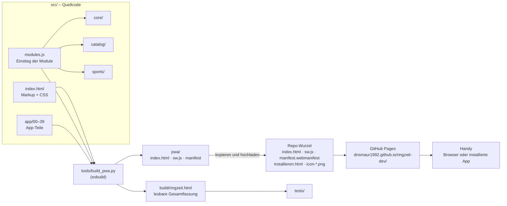
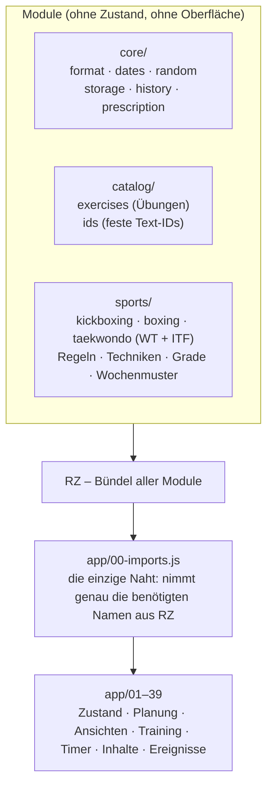
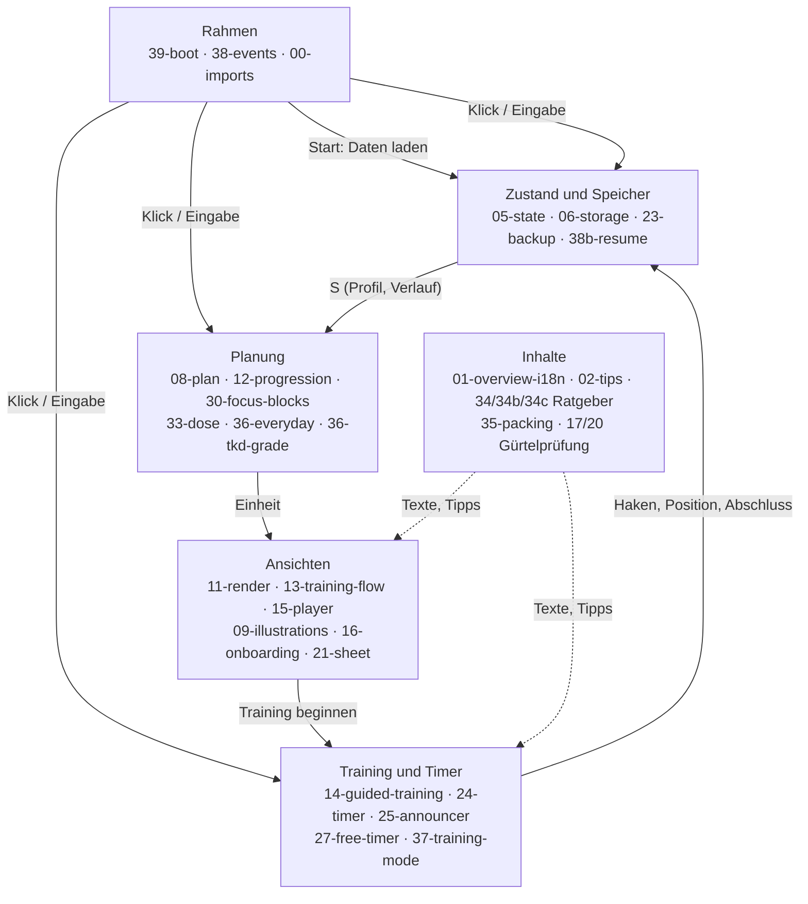
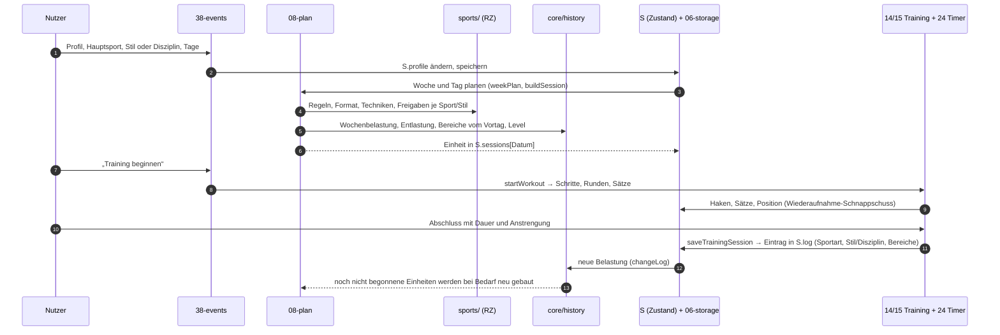
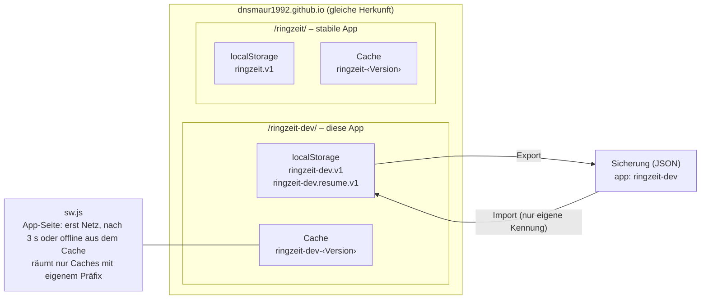

# Komponenten und Zusammenspiel

Diese Seite zeigt, **welche Dateien was tun und wie sie zusammenarbeiten**: vom Quellcode über den Build bis zur App
auf dem Handy, und innerhalb der App vom Profil bis zum Verlaufseintrag. Die Einzelheiten zu Modulen und Regeln
stehen in [architecture.md](architecture.md).

---

## 1. Der Weg vom Quellcode zur App

| Schritt | Was passiert | Dateien |
|---|---|---|
| 1 | Die gemeinsamen Module werden zu **einem Bündel `RZ`** gepackt | `src/modules.js` → `core/`, `catalog/`, `sports/` |
| 2 | Markup, `RZ` und alle App-Teile (in Dateinamen-Reihenfolge) ergeben **eine HTML-Datei** | `tools/build_pwa.py`, `src/index.html`, `src/app/*.js` |
| 3 | Die lesbare Fassung prüfen die Tests | `build/ringzeit.html`, `tests/` |
| 4 | Die komprimierte App, der Service Worker (Versionsnummer = Zeitstempel) und das Manifest entstehen | `pwa/` |
| 5 | Der Betreiber lädt `pwa/index.html`, `pwa/sw.js` (und bei Änderung `manifest.webmanifest`) samt Quelldateien hoch | Repo-Wurzel |
| 6 | GitHub Pages liefert aus, das Handy holt das Update beim nächsten Start | `sw.js` |

---

## 2. Die Schichten im Code

**Regel:** Module in `core/`, `catalog/` und `sports/` kennen weder App-Zustand noch Oberfläche: kein `S`, kein
`ui`, kein `t()`, kein DOM, kein `localStorage`. Sie bekommen alles als Eingabe. Der Test „boundaries“ in
`tests/core.test.mjs` prüft das.

| Modul | Aufgabe | Wichtigste Namen |
|---|---|---|
| `core/history.js` | Belastung (Minuten × Anstrengung), Entlastung, Wochenprojektion, Körperbereiche (auch Taekwondo je Stil), Level je Sport und Stil | `entryLoad`, `weekLoadSum`, `deloadFor`, `projectWeek`, `entryRegions`, `lightRegions`, `levelFor`, `tkdRegions` |
| `core/prescription.js` | Dosierung: Text, Timerphasen und Zeit aus **einer** Vorgabe | `RX`, `rxText`, `rxPlan`, `rxSeconds` |
| `core/storage.js` | Speichern auf dem Gerät | `createStore` |
| `catalog/` | Übungskatalog mit festen Text-IDs, Umrechnung alter Nummern | `EX`, `EX_KEYS`, `keyOfLegacy` |
| `sports/kickboxing` | WAKO-Disziplinen, Techniken, Kombinationen, Kickketten | `TECH`, `COMBOS`, `EXTRA`, `KICK_CHAINS` |
| `sports/boxing` | DBV-Altersklassen und Formate, Schlagkombinationen, Partneraufgaben | `BOXT`, `BOX_TASKS`, `dbvClass`, `boxStandard` |
| `sports/taekwondo` | WT/DTU und ITF-D: Grade, Formen, Wartezeiten, Techniken, Freigaben, Formate, Wochenmuster | `TKDT` (WT + Grade + Regeln), `ITFT` (ITF) |
| `sports/index.js` | Register der Sportarten | `sportFor`, `visibleSports`, `SPORTS` |

---

## 3. Die App-Teile nach Aufgabe

| Bereich | Dateien | Aufgabe |
|---|---|---|
| **Zustand und Speicher** | `05-state`, `06-storage`, `23-backup-summary`, `38b-resume` | Startzustand; Laden, Umwandeln und Speichern (`hydrate`, `migrate`); Sicherung exportieren und importieren; Wiederaufnahme nach Neustart |
| **Planung** | `07-fitness-test`, `08-plan`, `12-progression`, `22-moving`, `28-my-combos`, `30-focus-blocks`, `33-dose`, `36-everyday`, `36-tkd-grade` | Wochenplan und Einheiten je Sportart bauen; Belastung und Entlastung; Steigerung; Schwerpunkt-Blöcke; Dosierung; Alltag; Taekwondo-Grade |
| **Ansichten** | `09-illustrations-seasons`, `11-render`, `13-training-flow`, `15-player`, `15b-profile`, `16-onboarding`, `18-tour`, `19-sketches`, `21-sheet`, `26-badges`, `29-first-steps`, `32-success` | Heute, Einheit, Test, Verlauf, Profil (Über mich, Termine & Ziele in `15b-profile`); Figuren und Jahreszeiten; Einrichtung und Tour; Skizzen; Blätter (Sheets); Abzeichen |
| **Training und Timer** | `14-guided-training`, `15-player`, `24-timer`, `25-announcer`, `27-free-timer`, `37-training-mode` | Geführtes Training Schritt für Schritt; Rundentimer mit gemeinsamer Uhr; Ansagen; freier Rundentimer; Vollbild |
| **Inhalte** | `01-overview-i18n`, `02-tips`, `10-loader`, `17-grading`, `20-grading-theory`, `34-guide`, `34b-guide-box`, `34c-guide-tkd`, `34d-relax`, `34e-arc`, `35-packing` | Alle Texte DE/EN; Tipps und Fakten; Ladebild; Gürtelprüfung Kickboxen; Ratgeber je Sportart; Entspannen (Atemübungen, Meditationen); Winter Arc; Packliste |
| **Rahmen** | `00-imports`, `31-install-share`, `38-events`, `39-boot` | Naht zu den Modulen; Installieren und Teilen; ein zentraler Klick- und Eingabe-Handler; Start |

---

## 4. Datenfluss: vom Profil zum Verlaufseintrag

**Wer liest was:**

| Daten | Wo | Geschrieben von | Gelesen von |
|---|---|---|---|
| Profil (Sport, Stil, Disziplin, Level, Tage, Grade …) | `S.profile` | Einrichtung, Profil, Gürtelbereich | Planung, Ansichten, Ratgeber, Tipps, Packliste, Rundentimer |
| Einheiten | `S.sessions[Datum]` | `buildSession` (08-plan) | Einheit, Training, Timer, Wiederaufnahme |
| Verlauf | `S.log` | Abschluss, Vereinstraining, Bearbeiten | Belastung, Bereiche, Steigerung, Verlauf, Abzeichen |
| Fitnesstests | `S.tests` | Test | Level je Sport und Stil (`levelFor`) |
| Verschiebungen, Ausfälle | `S.ov`, `S.cov` | Wochenplan, Vereinstraining | Wochenplan |
| Pausen, K.o. | `S.pauses`, `S.ko` | Alltag & Pausen | Planung (Sperren, Wiedereinstieg) |

---

## 5. Speicher, Offline und die stabile App

- **Trennung:** Beide Apps liegen auf derselben Herkunft und trennen sich nur über Speicherschlüssel und Cache-Präfix. `tests/isolation.e2e.mjs` prüft das.
- **Release:** Kommt der Code mit der Kennung `ringzeit` ins stabile Repo, liest er die vorhandenen Daten aus `ringzeit.v1` und wandelt sie um. Getestet mit einer echten Sicherung, siehe [abloesung.md](abloesung.md).

---

## 6. Tests und was sie abdecken

| Test | Schicht | Inhalt |
|---|---|---|
| `tests/core.test.mjs` | Module | Format, Datum, Speicher, Modulgrenzen, Belastung, Bereiche, Level, Dosierung, Box- und Taekwondo-Daten |
| `tests/training.test.mjs` | ganze App im Node-VM | Planung je Sport, Ereignisse, Training, Timer, Wiederaufnahme, Ansagen, Verlauf, Ratgeber, Texte |
| `tests/baseline.mjs` | Planung Kickboxen | Vergleichsbasis: bei reinen Umbauten bleiben die Kickbox-Pläne gleich |
| `tests/isolation.e2e.mjs` | Browser | Dev-App und stabile App stören sich nicht |
| `tests/final-check.mjs` | ganze App | Gesamtprüfung: jede Einheit aller Sportprofile bis zum Abschluss, H1–H9 |
| `tests/final-browser.cjs` | Browser, ausgelieferter Stand | Ansichten 390 px, Offline, Inbetriebnahme |

---

## 7. Wo ändere ich was?

| Ich will … | Datei |
|---|---|
| einen Text ändern (DE/EN) | `src/app/01-overview-i18n.js` |
| eine Regel einer Sportart ändern (Format, Altersklasse, Sperre) | `src/sports/<sport>/rules.js` |
| Techniken oder Kombinationen ändern | `src/sports/<sport>/techniques.js`, für ITF `src/sports/taekwondo/itf.js` |
| Grade, Formen oder Wartezeiten (Taekwondo) ändern | `src/sports/taekwondo/grades.js` |
| eine Übung ergänzen | `src/catalog/exercises.js` **und** `src/catalog/ids.js` (neue ID nur am Ende anhängen) |
| Dosierung und Timer einer Übung ändern | `src/core/prescription.js` |
| den Aufbau einer Einheit ändern | `src/app/08-plan.js` (`buildSessionCore`) |
| Tipps und Fakten ändern | `src/app/02-tips.js` |
| den Ratgeber ändern | `src/app/34-guide.js` (allgemein), `34b-guide-box.js` (Boxen), `34c-guide-tkd.js` (Taekwondo) |
| einen Release für die stabile App bauen | `python3 tools/release.py <leerer Ordner>`, danach [release.md](release.md) |
| „Was ist neu“ ändern | Texte unter `news` in `01-overview-i18n.js`, Zähler `NEWS_V` in `16-onboarding.js` |

Danach: `python3 tools/build_pwa.py`, Tests laufen lassen, `pwa/index.html` und `pwa/sw.js` in die Repo-Wurzel kopieren und alles hochladen.
